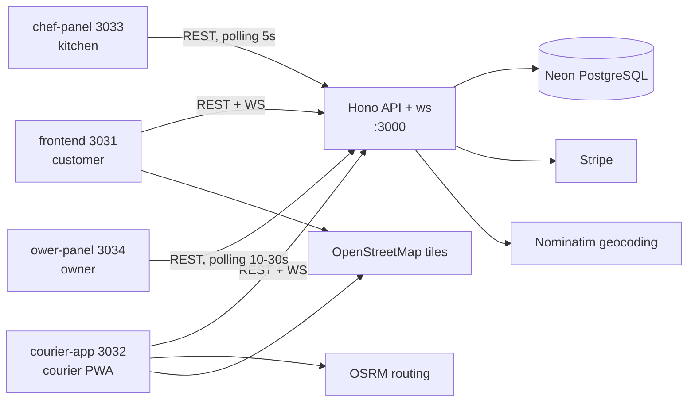
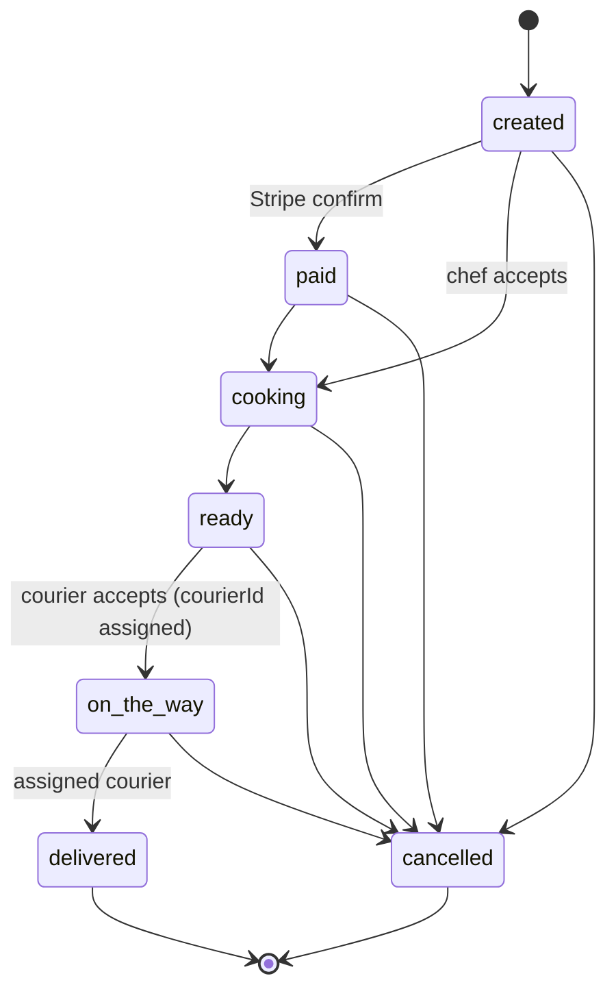

# 🍕 Food Delivery System

Повний цикл доставки їжі: вітрина для клієнта, кухня, кур'єрський PWA і панель власника. П'ять незалежних застосунків навколо одного REST/WebSocket API.

> `project.*.spec.md` — початкові проєктні специфікації. Вони описують задум, а не поточний код. Актуальний стан описано тут і в `docs/`. Де специфікація розходиться з кодом — правий код.

## Застосунки

| Застосунок | Стек | Порт | Роль |
|---|---|---|---|
| `backend` | Node.js, Hono, Drizzle ORM, Neon PostgreSQL, Zod, JWT, ws, Stripe | 3000 | REST API, WebSocket, платежі, геокодинг |
| `frontend` | SvelteKit 5 (runes), Tailwind 4, Leaflet, Stripe.js | 3031 | Вітрина, кошик, checkout, трекінг замовлення, чат |
| `courier-app` | Vue 3.5, Pinia, vue-router, Vite 7, Leaflet, PWA | 3032 | Черга доставок, маршрут до клієнта, чат |
| `сhef-panel` | React 18, Vite, TanStack Query | 3033 | Кухня: замовлення, рецепти, склад |
| `ower-panel` | React 18, Vite, TanStack Query, Recharts | 3034 | Власник: дашборд, персонал, зарплати, фінанси, кухня, налаштування, аудит |

`сhef-panel` починається з кириличної `с` (U+0441), `ower-panel` — з латинської `o`.

## Ролі

| Роль | Що може |
|---|---|
| `customer` | Каталог, кошик, свої замовлення, трекінг, чат по замовленню |
| `courier` | Список готових доставок, прийняття, маршрут, локація, чат, доставлено |
| `chef` | Черга кухні, статуси `created → cooking → ready`, склад, рецепти |
| `owner` | Усе: кухня, персонал, зарплати, фінанси, налаштування, аудит |
| `admin` | Те саме, що owner, крім зміни власника; входить і в owner-панель, і в кухню |

## Швидкий старт

```bash
# 1. Backend
cd backend
npm install
cp .env.example .env          # POSTGRES_URL, JWT_SECRET, JWT_REFRESH_SECRET, STRIPE_*
npm run db:push
npm run db:seed
npm run dev                   # http://localhost:3000

# 2. Клієнт
cd frontend
npm install
cp .env.example .env          # PUBLIC_API_URL, PUBLIC_STRIPE_PUBLISHABLE_KEY
npm run dev                   # http://localhost:3031

# 3. Кур'єр
cd courier-app && npm install && npm run dev     # http://localhost:3032

# 4. Кухня
cd сhef-panel && npm install && npm run dev      # http://localhost:3033

# 5. Власник
cd ower-panel && npm install && npm run dev      # http://localhost:3034
```

Кореневого `package.json` немає: кожен застосунок ставиться й запускається зі своєї теки. CORS у `backend/src/index.ts` дозволяє 3000, 3031, 3032, 3033, 3034.

## Архітектура



Деталі: [`docs/ARCHITECTURE.md`](docs/ARCHITECTURE.md).

## Життєвий цикл замовлення



Переходи валідуються на бекенді (`allowedTransitions` у `backend/src/routes/orders.ts`); кур'єр може ставити лише `on_the_way` і `delivered`, і лише для замовлення, яке ще нікому не призначене. Деталі: [`docs/ORDER-LIFECYCLE.md`](docs/ORDER-LIFECYCLE.md).

## Відстеження і чат

- Клієнт вказує точку доставки на checkout: `navigator.geolocation`, а якщо вона недоступна — бекенд геокодить адресу через Nominatim (`POST /geo/geocode`). Точка зберігається в `orders.lat/lng`.
- Кур'єр приймає замовлення → `orders.courierId`. Позиція кур'єра пише в `courier_locations` через WS (`courier_location_update`) або HTTP (`PUT /orders/:id/location`).
- Клієнт бачить кур'єра на `/orders/:id`: карта, маркер, лінія, статус-таймлайн, телефон і чат. Дані — `GET /orders/:id/tracking` + WS-канал `order:<id>` + полінг 5 с.
- Кур'єр на `/orders/:id/map` бачить маршрут до клієнта (OSRM) з відстанню й ETA.
- Чат прив'язаний до замовлення: клієнт ↔ кур'єр ↔ адмін/власник (`/chats/order/:orderId/messages`).

Деталі: [`docs/REALTIME.md`](docs/REALTIME.md), [`docs/TRACKING-AND-CHAT.md`](docs/TRACKING-AND-CHAT.md).

## WebSocket

`ws://localhost:3000/ws`, конверт `{ "type": ..., "data": ... }`.

| Клієнт → сервер | Призначення |
|---|---|
| `auth` | JWT access token |
| `subscribe` / `unsubscribe` | Канал `order:<id>` (перевіряється доступ) або `orders` |
| `courier_location_update` | `{ orderId, lat, lng }` від кур'єра |

| Сервер → клієнт | Коли |
|---|---|
| `new_order`, `order_updated`, `order_cancelled` | Створення / зміна статусу / скасування |
| `courier_location` | Нова позиція кур'єра (канал замовлення + ролі owner/admin) |
| `chat_message` | Нове повідомлення в чаті замовлення |

## API

Повний перелік: [`docs/API.md`](docs/API.md). Інтерактивна документація — `http://localhost:3000/api/docs`.

Ключові групи: `/auth`, `/users`, `/products`, `/categories`, `/tags`, `/orders`, `/cart`, `/payments`, `/chats`, `/geo`, `/inventory`, `/reviews`, `/owner`.

## Дані

22 таблиці в `backend/src/db/schema.ts`, включно з `orders.courierId/lat/lng`, `courier_locations`, `chats.orderId`. Схема й призначення кожної таблиці: [`docs/DATA-MODEL.md`](docs/DATA-MODEL.md).

## Тестові акаунти

| Email | Пароль | Роль |
|---|---|---|
| `owner@test.com` | `owner123` | owner |
| `admin@test.com` | `admin123` | admin |
| `cura1@mail.com` | `cura123` | courier |
| `cura2@mail.com` | `cura123` | courier |

## Документація

| Файл | Про що |
|---|---|
| [`docs/ARCHITECTURE.md`](docs/ARCHITECTURE.md) | Компоненти, технології, потоки даних, авторизація, env |
| [`docs/DATA-MODEL.md`](docs/DATA-MODEL.md) | ER-схема і всі 22 таблиці |
| [`docs/ORDER-LIFECYCLE.md`](docs/ORDER-LIFECYCLE.md) | Статуси, матриця переходів, права ролей, оплата |
| [`docs/REALTIME.md`](docs/REALTIME.md) | Протокол WebSocket, канали, фолбеки |
| [`docs/TRACKING-AND-CHAT.md`](docs/TRACKING-AND-CHAT.md) | Геолокація, геокодинг, маршрут, чат по замовленню |
| [`docs/USER-STORIES.md`](docs/USER-STORIES.md) | Сценарії за ролями, що реалізовано, що ні |
| [`docs/API.md`](docs/API.md) | Усі ендпоінти з правами |
| [`courier-app/README.md`](courier-app/README.md) | Кур'єрський застосунок |
| [`frontend/README.md`](frontend/README.md) | Клієнтський застосунок |
| [`ower-panel/README.md`](ower-panel/README.md) | Панель власника |

## Відомі обмеження

- **Геолокація в тестовому браузері.** У середовищі перевірки Chrome має `denied` для geolocation, тому маршрут кур'єра будувався без стартової точки. Код обробляє це чесно (кнопка «Share my location» неактивна, карта показує адресу), але в такому браузері OSRM-маршрут не намалюється.
- **Готівка.** Замовлення з `paymentType: cash` створюється з `paymentStatus: pending` і не має окремого ендпоінта «оплачено готівкою»; дохід у фінансах рахується лише за `paid`.
- **Адмін-панелі немає.** Роль `admin` користується owner-панеллю (її API дозволяє `owner` і `admin`, UI-гард — лише `owner`).
- **OpenAPI.** Документовані лише частина маршрутів; `/orders`, `/chats`, `/geo`, `/owner` в OpenAPI не описані.
- **Тести не герметичні.** `backend` Vitest ходить у живий `localhost:3000` і пише в БД; у `src/tests/api.test.ts` є застаріле очікування масиву `/products`.
- **Чати поза замовленням.** Старі `/chats` (клієнт ↔ адмін) залишені в API, але UI не використовує їх; робочий чат — тільки `/chats/order/:orderId`.