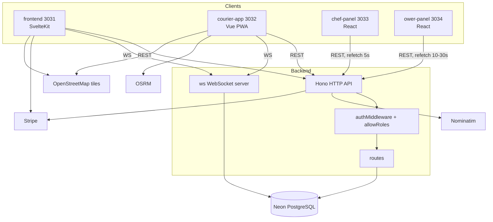
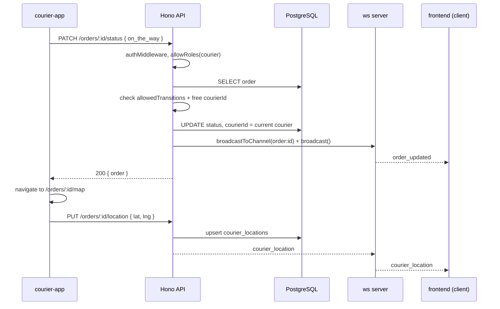

# Architecture

## Overview

Five separate applications that have no shared `package.json` and build independently. The only connection between them is HTTP/WebSocket API at `http://localhost:3000` and a shared Neon PostgreSQL database.



## Backend Components

| Component | File | Purpose |
|-----------|------|---------|
| HTTP server | `backend/src/index.ts` | Hono, CORS, logging, route mounting, OpenAPI, `/health` |
| WebSocket | `backend/src/websocket.ts` | `ws` on `/ws`, JWT auth, channels, relay location |
| Tracking service | `backend/src/services/tracking.ts` | Validate and upsert courier position in `courier_locations` |
| Schema | `backend/src/db/schema.ts` | 22 tables with Drizzle |
| Connection | `backend/src/db/index.ts` | `drizzle-orm/neon-http`, `dotenv` |
| Middleware | `backend/src/middleware/auth.ts` | Bearer token, `userId`/`userRole`, `allowRoles()` |
| Routes | `backend/src/routes/*.ts` | 13 route groups |
| OpenAPI | `backend/src/openapi/*` | Separate implementation for `/api/*`, Scalar UI |

## Key Features

- **NodeNext ESM**: relative imports need `.js` suffix even in `.ts` files.
- **JWT secrets** read at module load time (`utils/auth.ts`), so `.env` must be loaded before startup; `dotenv` is pulled in via imports of `db/index.ts` and `index.ts`. Import order matters when refactoring.
- **OpenAPI routes** duplicate logic rather than delegate. They cover only part of the API.
- **Errors** are `{ "error": "...", "code": 4xx }` with appropriate HTTP status.
- **`db:push`** applies schema directly (migrations not committed, `drizzle/` in `.gitignore`).

## Authorization

1. `POST /auth/login` → `{ user, accessToken, refreshToken }`. Access — JWT for 15 minutes (`expiresIn: '15m'`), refresh — 7 days and stored in `refresh_tokens`.
2. Each protected request carries `Authorization: Bearer <accessToken>`; `authMiddleware` sets `userId` and `userRole` in context.
3. `allowRoles([...])` restricts endpoints to specific roles.
4. After `401`:

| Client | Behavior |
|--------|----------|
| `frontend` | `apiFetch` does `POST /auth/refresh`, saves new pair and retries the request once (`refreshInFlight` deduplicates parallel attempts) |
| `courier-app` | axios interceptor in `src/api/client.js`: `401` → `authStore.refresh()` → retry request; if refresh fails → `logout()` and redirect to `/` |
| `ower-panel` / `сhef-panel` | axios interceptor with same refresh-retry |
| WebSocket | `auth` message with access token; `order:<id>` channel verifies access to order |

Tokens live in `localStorage` (`accessToken`, `refreshToken`, `user`). No cookie sessions.

## Client Applications

| Application | Routing | State Management | Updates |
|-------------|---------|------------------|---------|
| `frontend` | File-based (SvelteKit) | Svelte 5 runes + store modules | REST + WS on tracking page + polling every 5s |
| `courier-app` | vue-router | Pinia (`auth`, `order`, `chat`, `location`, `socket`) | WS + polling every 15s |
| `сhef-panel` | react-router | TanStack Query | `refetchInterval: 5000` |
| `ower-panel` | react-router | TanStack Query | 10–30s depending on page |

## External Services

| Service | Location | Purpose | Key |
|---------|----------|---------|-----|
| Stripe | `backend/src/routes/payments.ts`, checkout | PaymentIntent, webhook, cards | `STRIPE_SECRET_KEY`, `PUBLIC_STRIPE_PUBLISHABLE_KEY` |
| Nominatim | `backend/src/routes/geo.ts` | Address → coordinates, when client doesn't provide geo | No key needed, `User-Agent` required |
| OSRM (public) | `courier-app/src/views/OrderRouteView.vue` | Routing, distance, ETA | No key needed |
| OpenStreetMap tiles | client maps | Map tile layer | No key needed |

Nominatim results cached in process memory (`Map`), so re-geocoding same address doesn't hit network.

## Configuration

`backend/.env`:

```
POSTGRES_URL=postgresql://...
JWT_SECRET=...
JWT_REFRESH_SECRET=...
STRIPE_SECRET_KEY=sk_test_...
STRIPE_WEBHOOK_SECRET=whsec_...
PORT=3000
```

`frontend/.env`:

```
PUBLIC_API_URL=http://localhost:3000
PUBLIC_STRIPE_PUBLISHABLE_KEY=pk_test_...
```

`courier-app`, `сhef-panel`, `ower-panel` have no `.env`: API address is hardcoded (`http://localhost:3000`).

## Request Flow Example: Courier Accepting Order



## Development & Testing

- `npm run dev` — `tsx watch src/index.ts` (backend), Vite (rest).
- Builds: `npm run build` in each app; `сhef-panel` uses `tsc -b && vite build`.
- Backend tests not hermetic: they run against live API on 3000 and write to DB.
- CORS allows only localhost ports 3000/3031/3032/3033/3034; new dev origin must be added to `backend/src/index.ts`.