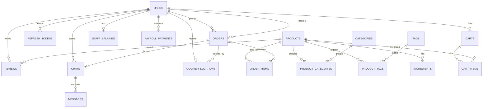

# ER Diagram

Schema: `backend/src/db/schema.ts` (22 tables). Money and coordinates are `numeric`, so they arrive as **strings** in API; time is `timestamp` (UTC). Applied via `npm run db:push`. Migrations not committed; `drizzle/` is gitignored.