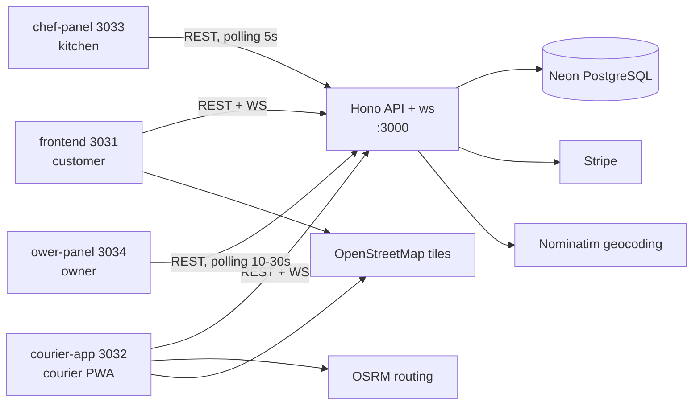
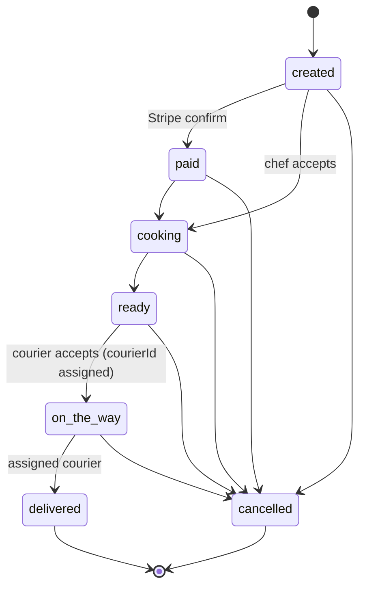

# Food Delivery System

A full-cycle food delivery platform: customer storefront, kitchen panel, courier PWA, and owner dashboard. Five independent applications around one REST/WebSocket API.

> `project.*.spec.md` — initial project specifications. They describe the intent, not the current code. The current state is described here and in `docs/`. Where spec and code differ — the code wins.

## Applications

| Application | Stack | Port | Role |
|-------------|-------|------|------|
| `backend` | Node.js, Hono, Drizzle ORM, Neon PostgreSQL, Zod, JWT, ws, Stripe | 3000 | REST API, WebSocket, payments, geocoding |
| `frontend` | SvelteKit 5 (runes), Tailwind 4, Leaflet, Stripe.js | 3031 | Storefront, cart, checkout, order tracking, chat |
| `courier-app` | Vue 3.5, Pinia, vue-router, Vite 7, Leaflet, PWA | 3032 | Delivery queue, route to customer, chat |
| `сhef-panel` | React 18, Vite, TanStack Query | 3033 | Kitchen: orders, recipes, inventory |
| `ower-panel` | React 18, Vite, TanStack Query, Recharts | 3034 | Owner: dashboard, staff, payroll, finances, kitchen, settings, audit |

`сhef-panel` starts with Cyrillic `с` (U+0441), `ower-panel` — with Latin `o`.

## Roles

| Role | Capabilities |
|------|--------------|
| `customer` | Catalog, cart, own orders, tracking, order chat |
| `courier` | Ready deliveries list, acceptance, route, location, chat, mark delivered |
| `chef` | Kitchen queue, statuses `created → cooking → ready`, inventory, recipes |
| `owner` | Everything: kitchen, staff, payroll, finances, settings, audit |
| `admin` | Same as owner, except changing owner; accesses both owner and chef panels |

## Quick Start

```bash
# 1. Backend
cd backend
npm install
cp .env.example .env          # POSTGRES_URL, JWT_SECRET, JWT_REFRESH_SECRET, STRIPE_*
npm run db:push
npm run db:seed
npm run dev                   # http://localhost:3000

# 2. Customer
cd frontend
npm install
cp .env.example .env          # PUBLIC_API_URL, PUBLIC_STRIPE_PUBLISHABLE_KEY
npm run dev                   # http://localhost:3031

# 3. Courier
cd courier-app && npm install && npm run dev     # http://localhost:3032

# 4. Kitchen
cd сhef-panel && npm install && npm run dev      # http://localhost:3033

# 5. Owner
cd ower-panel && npm install && npm run dev      # http://localhost:3034
```

No root `package.json`: each app installs and runs from its own directory. CORS in `backend/src/index.ts` allows 3000, 3031, 3032, 3033, 3034.

## Architecture Overview



Details: [Architecture](/en/architecture)

## Order Lifecycle



Transitions validated on backend (`allowedTransitions` in `backend/src/routes/orders.ts`); courier can only set `on_the_way` and `delivered`, and only for order not yet assigned. Details: [Order Lifecycle](/en/order-lifecycle/statuses)

## Tracking & Chat

- Customer provides delivery point at checkout: `navigator.geolocation`, or backend geocodes address via Nominatim (`POST /geo/geocode`). Point stored in `orders.lat/lng`.
- Courier accepts order → `orders.courierId`. Courier position writes to `courier_locations` via WS (`courier_location_update`) or HTTP (`PUT /orders/:id/location`).
- Customer sees courier on `/orders/:id`: map, marker, line, status timeline, phone, chat. Data — `GET /orders/:id/tracking` + WS channel `order:<id>` + 5s polling.
- Courier on `/orders/:id/map` sees route to customer (OSRM) with distance & ETA.
- Chat bound to order: customer ↔ courier ↔ admin/owner (`/chats/order/:orderId/messages`).

Details: [Tracking & Chat](/en/tracking-chat/data-flow), [Realtime](/en/realtime/connection)

## WebSocket

`ws://localhost:3000/ws`, envelope `{ "type": ..., "data": ... }`.

| Client → Server | Purpose |
|-----------------|---------|
| `auth` | JWT access token |
| `subscribe` / `unsubscribe` | Channel `order:<id>` (access checked) or `orders` |
| `courier_location_update` | `{ orderId, lat, lng }` from courier |

| Server → Client | When |
|-----------------|------|
| `new_order`, `order_updated`, `order_cancelled` | Create / status change / cancel |
| `courier_location` | New courier position (order channel + owner/admin roles) |
| `chat_message` | New message in order chat |

## API

Full list: [API Reference](/en/api/auth). Interactive docs — `http://localhost:3000/api/docs`.

Key groups: `/auth`, `/users`, `/products`, `/categories`, `/tags`, `/orders`, `/cart`, `/payments`, `/chats`, `/geo`, `/inventory`, `/reviews`, `/owner`, `/calls`.

## Data

22 tables in `backend/src/db/schema.ts`, including `orders.courierId/lat/lng`, `courier_locations`, `chats.orderId`. Schema and purpose of each table: [Data Model](/en/data-model/er).

## Test Accounts

| Email | Password | Role |
|-------|----------|------|
| `owner@test.com` | `owner123` | owner |
| `admin@test.com` | `admin123` | admin |
| `cura1@mail.com` | `cura123` | courier |
| `cura2@mail.com` | `cura123` | courier |

## Documentation Structure

| File | About |
|------|-------|
| [Architecture](/en/architecture) | Components, tech, data flows, auth, env |
| [Data Model](/en/data-model/er) | ER diagram and all 22 tables |
| [Order Lifecycle](/en/order-lifecycle/statuses) | Statuses, transition matrix, role permissions, payment |
| [Realtime](/en/realtime/connection) | WebSocket protocol, channels, fallbacks |
| [Tracking & Chat](/en/tracking-chat/data-flow) | Geolocation, geocoding, route, order chat |
| [User Stories](/en/user-stories/customer) | Scenarios by role, what's implemented, what's not |
| [API Reference](/en/api/auth) | All endpoints with permissions |
| [Frontend (SvelteKit)](/en/apps/frontend) | Customer app |
| [Courier App (Vue PWA)](/en/apps/courier) | Courier app |
| [Chef Panel (React)](/en/apps/chef) | Kitchen app |
| [Owner Panel (React)](/en/apps/owner) | Owner app |
| [Development](/en/dev/testing) | Testing, env vars, DB commands, known issues |

## Known Limitations

- **Geolocation in test browser.** Test Chrome has `denied` for geolocation, so courier route built without start point. Code handles this honestly (button "Share my location" inactive, map shows address), but OSRM route won't render in such browser.
- **Cash.** Orders with `paymentType: cash` create with `paymentStatus: pending` and have no separate "mark paid cash" endpoint; revenue in finances counts only `paid`.
- **No separate admin panel.** Role `admin` uses owner panel (its API allows `owner` and `admin`, UI guard — only `owner`).
- **OpenAPI.** Only some routes documented; `/orders`, `/chats`, `/geo`, `/owner` not in OpenAPI.
- **Tests not hermetic.** `backend` Vitest hits live `localhost:3000` and writes to DB; `src/tests/api.test.ts` has stale assertion expecting array for `/products`.
- **Legacy chats.** Old `/chats` (customer ↔ admin) left in API but UI doesn't use them; working chat is only `/chats/order/:orderId`.