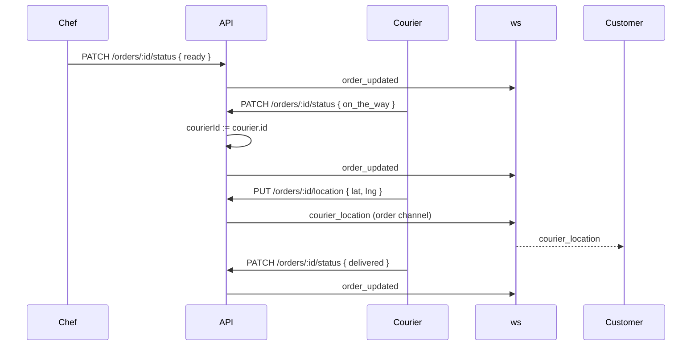

# Courier Flow

## Key Points

- **Order acceptance** is the act of accepting the order; there's no admin "assign another courier" feature.
- `courier_locations` stores only the latest position (upsert by `courierId`).
- Order can formally have `courierId` and status `delivered` — history is preserved.