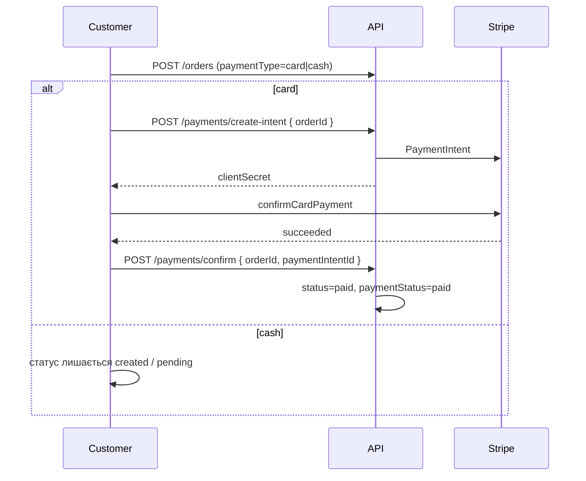

# Payment Flow

## Card Payment

- `POST /payments/webhook` handles `payment_intent.succeeded` and `.failed` regardless of browser.
- Cash: `paymentStatus` stays `pending`; no separate "mark as paid" endpoint. Such orders don't count in owner revenue (only `paid`).

## Cash Payment

- Order created with `paymentStatus: pending`.
- No separate endpoint to mark as paid.
- Revenue in owner panel counts only `paymentStatus = paid`.