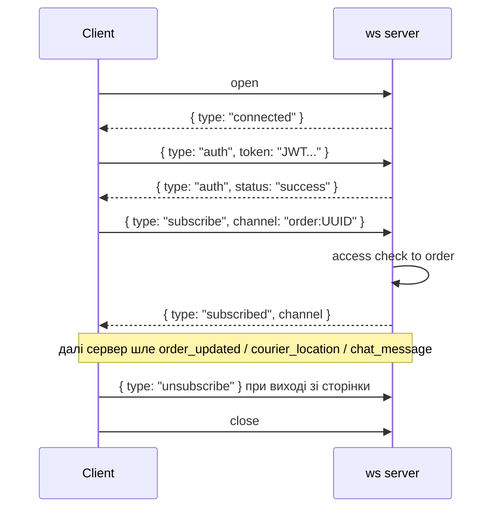

# Connection & Protocol

## URL

```
ws://localhost:3000/ws
```

## Server

`setupWebSocket()` у `backend/src/websocket.ts` (`WebSocketServer` з пакета `ws`). Кожне повідомлення має конверт `{ "type": "...", "data": ... }`.

```typescript
const message = JSON.stringify({ type: event, data });
```

## Client Initialization Flow



Клієнти перепідключаються самі: `courier-app` через 3 с, сторінка трекінгу — через 3 с, поки компонент живий.