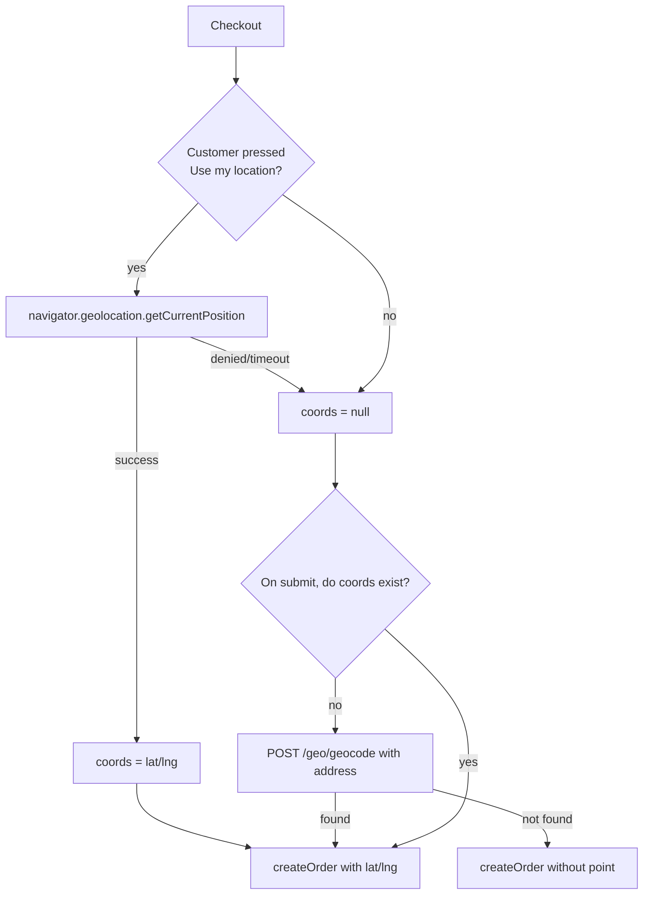

# Customer Location

The customer point is stored in `orders.lat` and `orders.lng`. It can come either from the browser geolocation API or from the backend geocoding of the text address.

## Checkout flow

- Geolocation is requested only when the customer presses the button, never automatically.
- On success `coords` is the pair from `navigator.geolocation.getCurrentPosition`; on denial or timeout `coords` stays `null`.
- On submit, if no coordinates are available the backend geocodes the text address. If the address is recognised, the order is created with the point; otherwise the order is created without a point.

## Backend geocoding

Geocoding is performed by the **backend** (`backend/src/routes/geo.ts`) rather than the browser, so it does not depend on CORS and hides the Nominatim policy. Results are cached in an in-memory `Map` keyed by the trimmed, lower-cased address (including negative results).

| Method | Path | Access | Body | Response |
|--------|------|--------|------|----------|
| `POST` | `/geo/geocode` | authenticated | `{ "address": "..." }` (at least 3 characters) | `{ lat, lng, displayName }` |

The handler queries `https://nominatim.openstreetmap.org/search` with `format=json`, `limit=1`, `addressdetails=0`, a `User-Agent` of `delivery-system-dev/1.0` and `Accept-Language: en`, then returns the first match.

| Situation | Status |
|-----------|--------|
| Address found | `200` with `{ lat, lng, displayName }` |
| No match | `404` `{ error: "Address not found" }` (cached as negative) |
| Nominatim not OK or network error | `502` `{ error: "Geocoding service unavailable" }` / `"Geocoding request failed"` |

## When there is no point

If the address is not recognised, the order is still created. The courier then sees the plain text address and the phone number instead of a map point. See [Courier Route](/en/tracking-chat/courier-route) for how the route behaves without a start point.
