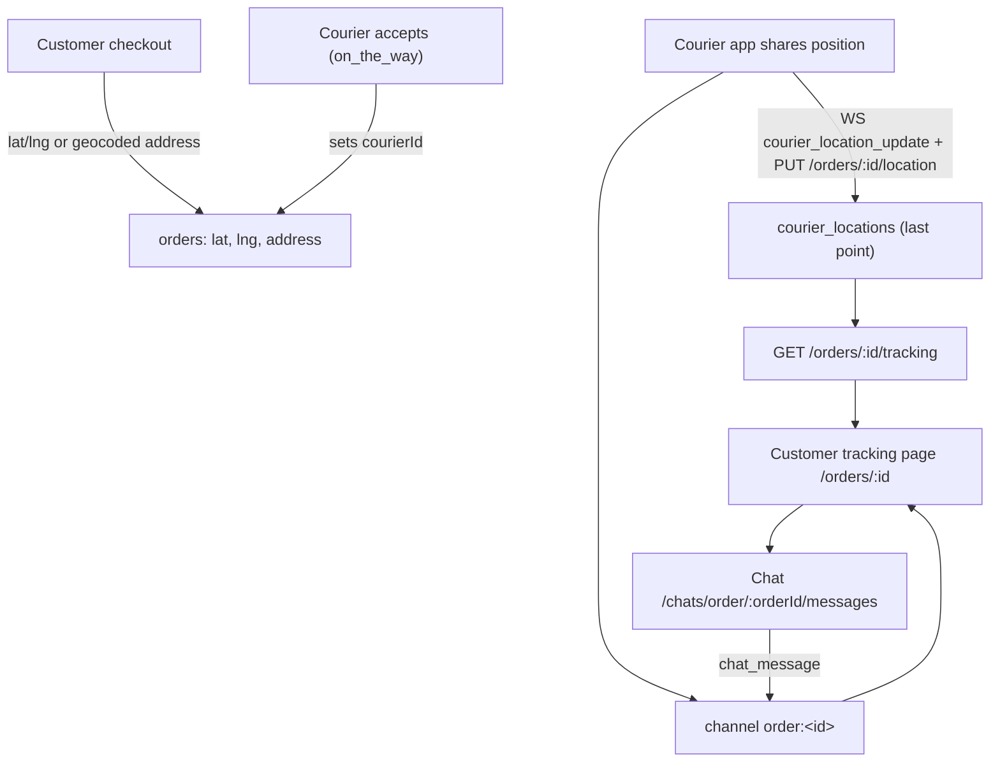

# Data Flow

After checkout the customer wants to see where the order is, the courier needs to know where to drive, and the admin wants to know who is carrying the order. The system connects these three parties through three things: the customer point stored on the order, the courier position, and a chat bound to the order.

## Where the data lives

| What | Where it is stored | Who writes it |
|------|--------------------|---------------|
| Customer point | `orders.lat`, `orders.lng` | Customer when creating the order |
| Order courier | `orders.courierId` | Backend at acceptance (`on_the_way`) |
| Courier position | `courier_locations` (last point) | Courier via WS or `PUT /orders/:id/location` |
| Chat | `chats.orderId` + `messages` | Customer, courier, admin/owner |

## Overall flow

The courier app (`courier-app`) is the source of the position; the customer app (`frontend`) and the staff panels are readers. Everything about one order travels over the single channel `order:<id>`.

## Realtime vs polling

| Data | Realtime | HTTP fallback |
|------|----------|---------------|
| Courier position | `courier_location_update` (WS) | `PUT /orders/:id/location` |
| Order status | `order_updated` event | `PATCH /orders/:id/status` |
| Chat | `chat_message` event | `GET/POST /chats/order/:orderId/messages` |
| Tracking | `courier_location` | `GET /orders/:id/tracking` |

The WS envelope is `{ "type": "...", "data": ... }`; clients read `message.type`. Because there is no message queue and no heartbeat, events sent while a socket is reconnecting are lost — that is why clients also poll the state. See [Realtime (WebSocket)](/en/realtime/connection) and [Channels](/en/realtime/channels) for the full protocol.

## Where to go next

- [Customer Location](/en/tracking-chat/customer-location) — how the customer point appears.
- [Courier Route](/en/tracking-chat/courier-route) — how the courier route to the customer is built.
- [Customer Tracking Page](/en/tracking-chat/customer-tracking) — what the customer sees.
- [Order Chat](/en/tracking-chat/order-chat) — the chat bound to the order.
