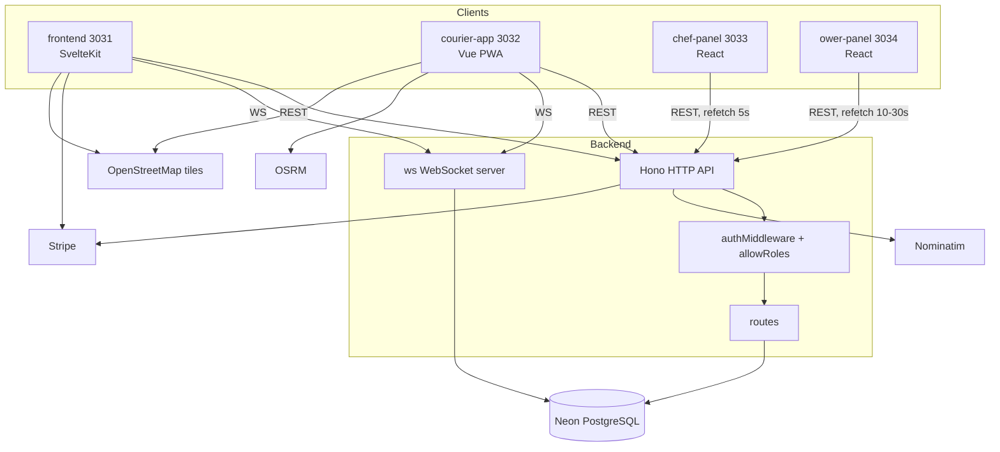
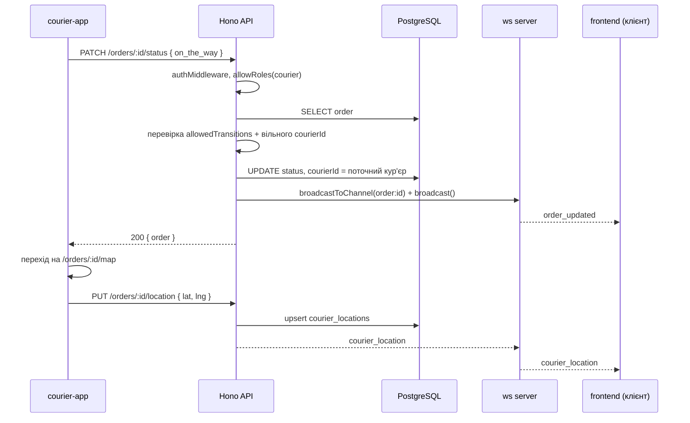

# Архітектура

## Огляд

П'ять окремих застосунків, які не мають спільного `package.json` і збираються незалежно. Єдине, що їх зв'язує, — HTTP/WebSocket API на `http://localhost:3000` і спільна база Neon PostgreSQL.



## Компоненти бекенду

| Компонент | Файл | Призначення |
|-----------|------|-------------|
| HTTP-сервер | `backend/src/index.ts` | Hono, CORS, логування, монтування роутерів, OpenAPI, `/health` |
| WebSocket | `backend/src/websocket.ts` | `ws` на `/ws`, автентифікація JWT, канали, релей локації |
| Сервіс трекінгу | `backend/src/services/tracking.ts` | Валідація й upsert позиції кур'єра в `courier_locations` |
| Схема | `backend/src/db/schema.ts` | 22 таблиці Drizzle |
| Підключення | `backend/src/db/index.ts` | `drizzle-orm/neon-http`, `dotenv` |
| Мідлвар | `backend/src/middleware/auth.ts` | Bearer-токен, `userId`/`userRole`, `allowRoles()` |
| Роутери | `backend/src/routes/*.ts` | 13 груп ендпоінтів |
| OpenAPI | `backend/src/openapi/*` | Окрема реалізація для `/api/*`, Scalar UI |

## Особливості

- **NodeNext ESM**: відносні імпорти з `.js` навіть у `.ts`.
- **JWT-секрети** читаються на етапі завантаження модуля (`utils/auth.ts`), тому `.env` мусить бути завантажений до старту; `dotenv` тягнеться через імпорти `db/index.ts` та `index.ts`. Порядок імпортів важливий при рефакторингу.
- **OpenAPI-роутери** дублюють логіку, а не делегують у звичайні. Вони покривають лише частину API.
- **Помилки** повертаються як `{ "error": "...", "code": 4xx }` з відповідним HTTP-статусом.
- **`db:push`** застосовує схему напряму (міграції не комітяться, `drizzle/` у `.gitignore`).

## Авторизація

1. `POST /auth/login` → `{ user, accessToken, refreshToken }`. Access — JWT на 15 хвилин (`expiresIn: '15m'`), refresh — 7 днів і зберігається в таблиці `refresh_tokens`.
2. Кожен захищений запит несе `Authorization: Bearer <accessToken>`; `authMiddleware` кладе `userId` і `userRole` у контекст.
3. `allowRoles([...])` обмежує ендпоінт ролями.
4. Після `401`:

| Клієнт | Поведінка |
|--------|-----------|
| `frontend` | `apiFetch` робить `POST /auth/refresh`, зберігає нову пару й повторює запит один раз (`refreshInFlight` дедуплікує паралельні спроби) |
| `courier-app` | axios-інтерсептор у `src/api/client.js`: `401` → `authStore.refresh()` → повторний запит; якщо refresh не вдався — `logout()` і перехід на `/` |
| `ower-panel` / `сhef-panel` | axios-інтерсептор з тим самим refresh-retry |
| WebSocket | `auth` повідомлення з access-токеном; канал `order:<id>` перевіряє доступ до замовлення |

Токени на клієнтах живуть у `localStorage` (`accessToken`, `refreshToken`, `user`). Cookie-сесій немає.

## Клієнтські застосунки

| Застосунок | Маршрутизація | Стан | Оновлення |
|-------------|---------------|------|-----------|
| `frontend` | файлова, SvelteKit | Svelte 5 runes + store-модулі | REST + WS на сторінці трекінгу + полінг 5 с |
| `courier-app` | vue-router | Pinia (`auth`, `order`, `chat`, `location`, `socket`) | WS + полінг 15 с |
| `сhef-panel` | react-router | TanStack Query | `refetchInterval: 5000` |
| `ower-panel` | react-router | TanStack Query | 10–30 с залежно від сторінки |

## Зовнішні сервіси

| Сервіс | Де | Навіщо | Ключ |
|--------|-----|--------|------|
| Stripe | `backend/src/routes/payments.ts`, checkout | PaymentIntent, webhook, картки | `STRIPE_SECRET_KEY`, `PUBLIC_STRIPE_PUBLISHABLE_KEY` |
| Nominatim | `backend/src/routes/geo.ts` | Адреса → координати, коли клієнт не дав геолокацію | не потрібен, `User-Agent` обов'язковий |
| OSRM (публічний) | `courier-app/src/views/OrderRouteView.vue` | Маршрут по дорогах, відстань, ETA | не потрібен |
| OpenStreetMap tiles | карти клієнта й кур'єра | Підкладка карти | не потрібен |

Nominatim-результати кешуються в пам'яті процесу (`Map`), тому повторний геокодинг тієї ж адреси не йде в мережу.

## Конфігурація

`backend/.env`:

```
POSTGRES_URL=postgresql://...
JWT_SECRET=...
JWT_REFRESH_SECRET=...
STRIPE_SECRET_KEY=sk_test_...
STRIPE_WEBHOOK_SECRET=whsec_...
PORT=3000
```

`frontend/.env`:

```
PUBLIC_API_URL=http://localhost:3000
PUBLIC_STRIPE_PUBLISHABLE_KEY=pk_test_...
```

`courier-app`, `сhef-panel`, `ower-panel` не мають `.env`: адреса API вшита в код (`http://localhost:3000`).

## Потік запиту (приклад: прийняття замовлення кур'єром)



## Запуск і перевірка

- `npm run dev` — `tsx watch src/index.ts` (backend), Vite (решта).
- Білди: `npm run build` у кожному застосунку; `сhef-panel` використовує `tsc -b && vite build`.
- Тести бекенду не герметичні: ходять у живий API на 3000 і пишуть у БД.
- CORS дозволяє лише локальні порти 3000/3031/3032/3033/3034; новий дев- origin треба додати в `backend/src/index.ts`.
