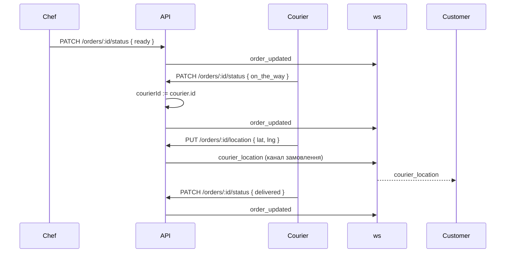

# Потік кур'єра

## Ключові моменти

- **Прийняття замовлення** — це й є прийняття. Немає адмінського "призначити іншого" кур'єра.
- `courier_locations` зберігає лише останню позицію (upsert за `courierId`).
- Замовлення може мати `courierId` і статус `delivered` — історія зберігається.
