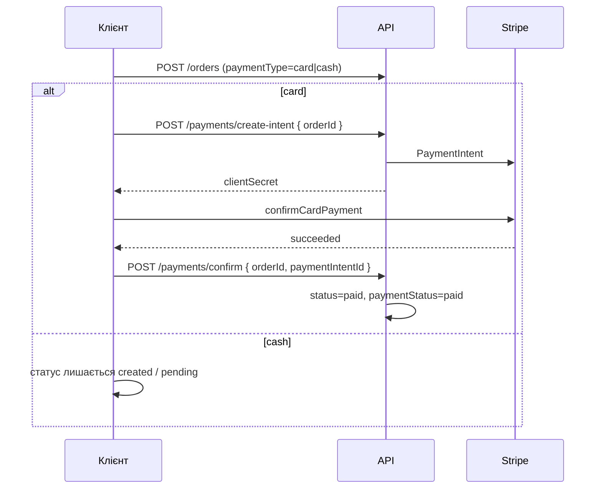

# Оплата

## Карткова оплата

- `POST /payments/webhook` обробляє `payment_intent.succeeded` і `.failed` незалежно від браузера.
- Готівка: `paymentStatus` лишається `pending`; немає окремого ендпоінта "оплачено". Такі замовлення не входять у дохід власника.

## Готівкова оплата

- Замовлення створюється з `paymentStatus: pending`.
- Немає окремого ендпоінта позначити як оплачене.
- Дохід у фінансах враховує лише `paymentStatus = paid`.
