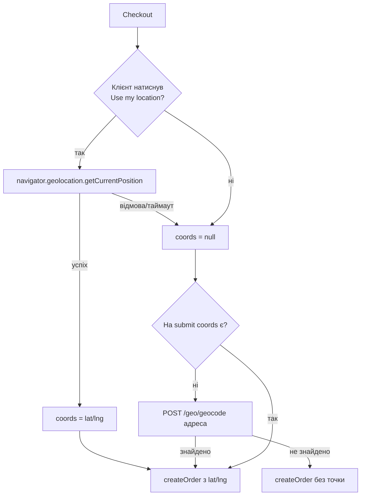

# Точка клієнта

Точка клієнта зберігається в `orders.lat` і `orders.lng`. Вона походить або з браузерного API геолокації, або з геокодування текстової адреси на бекенді.

## Потік оформлення

- Геолокація запитується лише за кнопкою, не автоматично.
- У разі успіху `coords` — пара, отримана з `navigator.geolocation.getCurrentPosition`; у разі відмови чи таймауту `coords` залишається `null`.
- На submit, якщо координат немає, бекенд геокодує текстову адресу. Якщо адресу розпізнано — замовлення створюється з точкою; інакше — без точки.

## Геокодування на бекенді

Геокодинг виконує **бекенд** (`backend/src/routes/geo.ts`), а не браузер, щоб не залежати від CORS і приховати політику Nominatim. Результати кешуються в пам'яті (`Map`) за ключем із нормалізованої (обрізаної та приведеної до нижнього регістру) адреси — включно з негативними результатами.

| Метод | Шлях | Доступ | Тіло | Відповідь |
|-------|------|--------|------|-----------|
| `POST` | `/geo/geocode` | автентифікований | `{ "address": "..." }` (щонайменше 3 символи) | `{ lat, lng, displayName }` |

Обробник звертається до `https://nominatim.openstreetmap.org/search` з параметрами `format=json`, `limit=1`, `addressdetails=0`, заголовком `User-Agent: delivery-system-dev/1.0` та `Accept-Language: en`, а тоді повертає перший збіг.

| Ситуація | Статус |
|----------|--------|
| Адресу знайдено | `200` з `{ lat, lng, displayName }` |
| Збігів немає | `404` `{ error: "Address not found" }` (кешується як негативний) |
| Nominatim не OK або помилка мережі | `502` `{ error: "Geocoding service unavailable" }` / `"Geocoding request failed"` |

## Коли точки немає

Якщо адресу не розпізнано, замовлення все одно створюється. Тоді кур'єр бачить звичайний текст адреси та номер телефону замість точки на карті. Про поведінку маршруту без стартової точки — у [Маршрут кур'єра](/uk/tracking-chat/courier-route).
