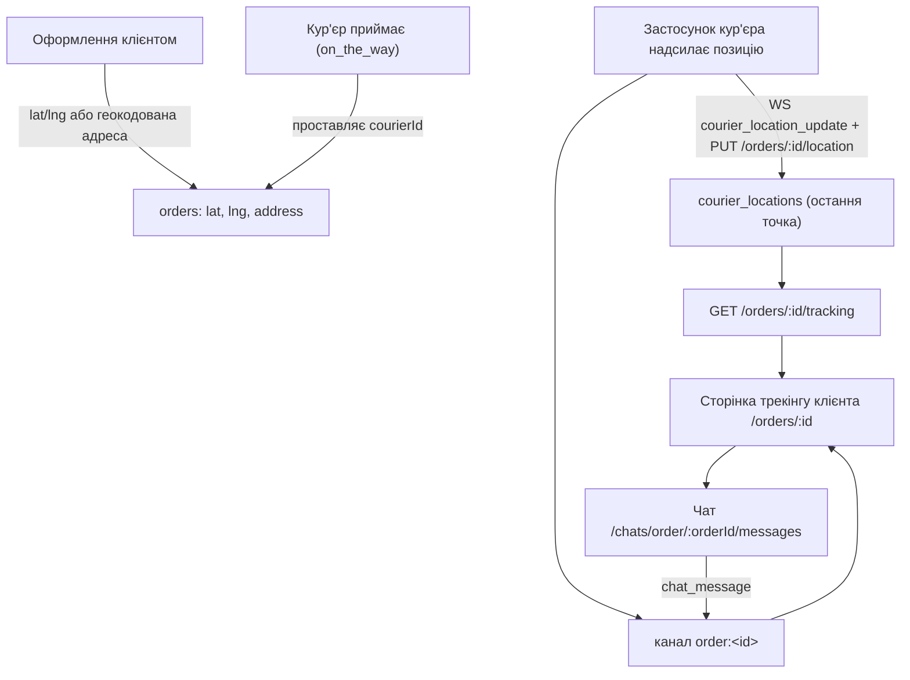

# Потік даних

Після оформлення клієнт хоче бачити, де його замовлення; кур'єр — куди їхати; адмін — хто везе. Система зв'язує ці три сторони через три речі: точку клієнта в замовленні, позицію кур'єра та чат, прив'язаний до замовлення.

## Де зберігаються дані

| Що | Де зберігається | Хто пише |
|----|-----------------|----------|
| Точка клієнта | `orders.lat`, `orders.lng` | Клієнт при створенні замовлення |
| Кур'єр замовлення | `orders.courierId` | Бекенд у момент прийняття (`on_the_way`) |
| Позиція кур'єра | `courier_locations` (остання точка) | Кур'єр через WS або `PUT /orders/:id/location` |
| Чат | `chats.orderId` + `messages` | Клієнт, кур'єр, адмін/власник |

## Загальний потік

Джерело позиції — застосунок кур'єра (`courier-app`); застосунок клієнта (`frontend`) і панелі персоналу лише читають. Усі події одного замовлення йдуть єдиним каналом `order:<id>`.

## Realtime і полінг

| Дані | Realtime | HTTP-фолбек |
|------|----------|-------------|
| Позиція кур'єра | `courier_location_update` (WS) | `PUT /orders/:id/location` |
| Статус замовлення | подія `order_updated` | `PATCH /orders/:id/status` |
| Чат | подія `chat_message` | `GET/POST /chats/order/:orderId/messages` |
| Трекінг | `courier_location` | `GET /orders/:id/tracking` |

Конверт кожного WS-повідомлення — `{ "type": "...", "data": ... }`; клієнти читають `message.type`. Через відсутність черги повідомлень і heartbeat події, надіслані під час перепідключення, втрачаються — саме тому клієнти додатково полять стан. Повний протокол — у [Realtime (WebSocket)](/uk/realtime/connection) та [Канали](/uk/realtime/channels).

## Що далі

- [Точка клієнта](/uk/tracking-chat/customer-location) — як з'являється точка клієнта.
- [Маршрут кур'єра](/uk/tracking-chat/courier-route) — як будується маршрут до клієнта.
- [Сторінка трекінгу клієнта](/uk/tracking-chat/customer-tracking) — що бачить клієнт.
- [Чат замовлення](/uk/tracking-chat/order-chat) — чат, прив'язаний до замовлення.
