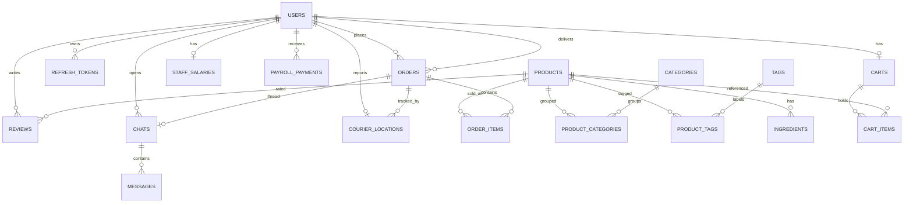

# Модель даних

Схема: `backend/src/db/schema.ts` (22 таблиці). Гроші й координати — `numeric`, тому в API вони приходять як **рядки**; час — `timestamp` (UTC). Застосовується через `npm run db:push` (міграцій у репозиторії немає).



## Довідники

| Таблиця | Поля | Призначення |
|---|---|---|
| `users` | `id`, `name`, `slug`, `email`, `passwordHash`, `role`, `cover`, `phone`, `address`, `isBlockedFromReviews`, `isBlocked`, `createdAt` | Усі акаунти: owner, admin, customer, chef, courier. `role` — текст, не enum БД |
| `refresh_tokens` | `id`, `userId`, `token`, `expiresAt`, `createdAt` | Refresh-токени (7 днів) |
| `categories` | `id`, `name`, `slug`, `cover`, `description` | Категорії меню |
| `products` | `id`, `name`, `slug`, `cover`, `price`, `description`, `createdBy`, `createdAt` | Страви |
| `tags` | `id`, `name`, `slug` | Теги страв |
| `product_categories` | `productId`, `categoryId` | M:N, складений PK |
| `product_tags` | `productId`, `tagId` | M:N, складений PK |
| `ingredients` | `id`, `productId`, `name`, `quantity`, `unit` | Склад страви |
| `inventory` | `id`, `name`, `slug`, `quantity`, `unit`, `cover`, `updatedAt` | Складські залишки; низький залишок — `quantity <= 10` |

## Замовлення

| Таблиця | Поля | Призначення |
|---|---|---|
| `orders` | `id`, `userId`, `totalPrice`, `status`, `deliveryType`, `address`, `phone`, `paymentType`, `paymentStatus`, `courierId`, `lat`, `lng`, `createdAt` | Замовлення. `courierId` — призначений кур'єр; `lat/lng` — точка клієнта (геолокація або геокодинг) |
| `order_items` | `id`, `orderId`, `productId`, `quantity`, `price` | Позиції; `price` фіксується на момент створення |

`status`: `created · paid · cooking · ready · on_the_way · delivered · cancelled`.
`deliveryType`: `pickup · delivery`.
`paymentType`: `card · cash`.
`paymentStatus`: `pending · paid · failed · refunded`.

`totalPrice` не перераховується після створення. `address` вільний текст, `lat/lng` — необов'язкові: якщо клієнт не дав геолокацію і геокодинг не знайшов адресу, точка відсутня, і кур'єр бачить лише текст.

## Кошик, відгуки, чат

| Таблиця | Поля | Призначення |
|---|---|---|
| `carts` | `id`, `userId` (unique), `updatedAt` | Один кошик на користувача |
| `cart_items` | `id`, `cartId`, `productId`, `quantity` | Позиції кошика |
| `reviews` | `id`, `userId`, `productId`, `rating`, `text`, `createdAt` | Відгук; унікальний на пару user+product |
| `chats` | `id`, `userId`, `orderId` (unique) | Чат. `orderId` — чат по замовленню; старі записи без `orderId` — клієнт ↔ адмін |
| `messages` | `id`, `chatId`, `sender`, `text`, `createdAt` | Повідомлення; `sender` = `user` (клієнт) · `courier` · `admin` |

## Трекінг

| Таблиця | Поля | Призначення |
|---|---|---|
| `courier_locations` | `courierId` (PK), `orderId`, `lat`, `lng`, `updatedAt` | Остання позиція кур'єра. Один рядок на кур'єра (upsert), не історія |

Історії переміщень немає: зберігається лише остання точка. `updatedAt` показується клієнту як «Courier position updated HH:MM».

## Панель власника

| Таблиця | Поля | Призначення |
|---|---|---|
| `staff_salaries` | `id`, `userId` (unique), `baseSalary`, `bonusPercentage`, `currency`, `updatedAt` | Умови оплати працівника |
| `payroll_payments` | `id`, `userId`, `amount`, `type`, `period`, `note`, `createdBy`, `createdAt` | Виплати: `type` = `salary` / `bonus` |
| `expenses` | `id`, `title`, `category`, `amount`, `note`, `createdBy`, `createdAt` | Витрати закладу |
| `restaurant_settings` | `id` (`main`), `name`, `phone`, `address`, `workingHours`, `currency`, `taxRate`, `deliveryFee`, `logo`, `cover`, `updatedAt` | Один рядок налаштувань |
| `audit_logs` | `id`, `userId`, `action`, `entity`, `entityId`, `details`, `createdAt` | Журнал змін: зарплати, виплати, витрати, налаштування, ціни/видалення продуктів |

Фінансовий результат у `/owner/finances`:

```
revenue = сума totalPrice замовлень зі status != 'cancelled' І paymentStatus = 'paid'
netProfit = revenue − payroll(period) − expenses(period)
```

Тобто готівкові замовлення з `paymentStatus = pending` у дохід не потрапляють, поки їх не позначено оплаченими (окремого ендпоінта для цього немає).

## Каскади

- `refresh_tokens`, `cart_items`, `messages`, `courier_locations`, `staff_salaries`, `payroll_payments` — `ON DELETE CASCADE` від батьківського запису.
- `order_items` — `ON DELETE CASCADE` від `orders`.
- `chats` — `ON DELETE CASCADE` від `orders` (видалення замовлення видаляє чат).
- `orders.userId`, `orders.courierId`, `products.createdBy` — без каскаду; видалення користувача з історією замовлень БД не пропустить.