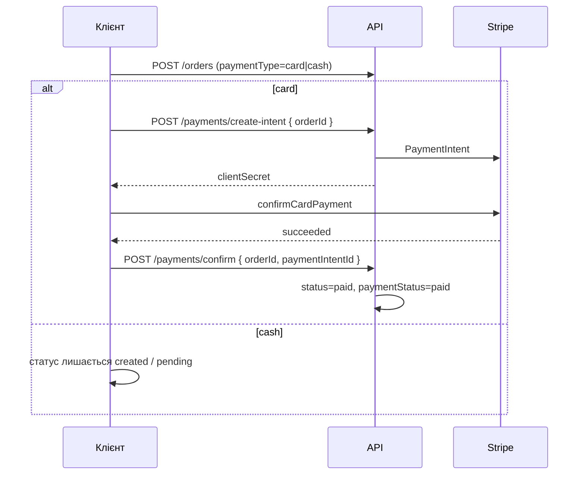
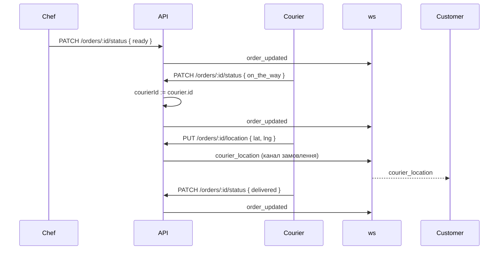

# Життєвий цикл замовлення

## Статуси

| Статус | Значення | Хто ставить |
|---|---|---|
| `created` | Замовлення створене, очікує оплати або підтвердження кухні | Система (`POST /orders`) |
| `paid` | Карткова оплата підтверджена Stripe | `POST /payments/confirm` або webhook |
| `cooking` | Кухня прийняла в роботу | `chef`, `admin`, `owner` |
| `ready` | Готово, чекає кур'єра | `chef`, `admin`, `owner` |
| `on_the_way` | Кур'єр прийняв і везе | Тільки `courier` |
| `delivered` | Доставлено | Призначений `courier`, або staff |
| `cancelled` | Скасовано | Клієнт (до `paid`), `owner`/`admin` (до `on_the_way`) |

## Матриця переходів

Реалізація — `allowedTransitions` у `backend/src/routes/orders.ts`. Будь-який інший перехід повертає `409`.

| З \ В | paid | cooking | ready | on_the_way | delivered | cancelled |
|---|---|---|---|---|---|---|
| `created` | ✅ | ✅ | — | — | — | ✅ |
| `paid` | — | ✅ | — | — | — | ✅ |
| `cooking` | — | — | ✅ | — | — | ✅ |
| `ready` | — | — | — | ✅ | — | ✅ |
| `on_the_way` | — | — | — | — | ✅ | ✅ |
| `delivered` | — | — | — | — | — | — |
| `cancelled` | — | — | — | — | — | — |

Додаткові правила для ролі `courier`:

- дозволені лише `on_the_way` і `delivered`;
- `on_the_way` можна поставити тільки з `ready`;
- якщо `courierId` уже встановлений іншим кур'єром → `409 Order already accepted by another courier`;
- якщо замовлення призначене іншому кур'єру → `403 Order is assigned to another courier`.

Скасування має окремий ендпоінт `POST /orders/:id/cancel`, який не користується матрицею:

- клієнт може скасувати лише власне замовлення у статусі `created` або `paid`;
- `owner`/`admin` — те саме;
- після `cooking` скасування через цей ендпоінт повертає `400`. Змінити на `cancelled` пізніші статуси можна лише через `PATCH /orders/:id/status` роллю staff.

## Хто що бачить і робить

| Роль | Бачить | Може змінювати |
|---|---|---|
| `customer` | Свої замовлення, трекінг, чат | Створити, скасувати до `paid`, писати в чат |
| `chef` | Усі замовлення (`GET /orders`), кухню | `created → cooking → ready`, `cancelled` |
| `courier` | Усі доставки (список `ready` + `on_the_way`) | Прийняти (`on_the_way`), завершити (`delivered`), локація, чат |
| `owner` / `admin` | Усе | Будь-який дозволений перехід, фінанси, персонал |

Важливо: `GET /orders` віддає **всі** замовлення (не фільтрує за кур'єром). Кур'єрський застосунок фільтрує на клієнті: `deliveryType === 'delivery'` і статус `ready` / `on_the_way` / `delivered`. Через це два кур'єри бачать той самий список «доступних», а бекенд вирішує, хто перший натиснув «Accept».

## Оплата

- `POST /payments/webhook` обробляє `payment_intent.succeeded` та `.failed` незалежно від браузера.
- Готівка: `paymentStatus` лишається `pending`; окремого «позначити оплаченим» немає. Тому такі замовлення не входять у дохід owner-панелі.
- `totalPrice` рахується на бекенді з поточних цін продуктів і фіксується в `order_items.price`; після цього ціна страви може змінитися, замовлення — ні.

## Кур'єр

- Призначення кур'єра — це і є прийняття замовлення; адмінського «призначити іншого» немає.
- `courier_locations` зберігає лише останню позицію (upsert за `courierId`).
- Формально замовлення може мати `courierId` і статус `delivered` — історія зберігається.

## Що бачить клієнт

| Стан | Сторінка `/orders/:id` |
|---|---|
| `created` / `paid` / `cooking` / `ready` | Таймлайн, точка доставки, чат; кур'єра ще немає |
| `on_the_way` | Маркер кур'єра, лінія до клієнта, «Courier position updated HH:MM», картка кур'єра з телефоном і кнопкою Call |
| `delivered` | Таймлайн завершено, полінг зупиняється |
| `cancelled` | Дані замовлення без активного трекінгу |

Сторінка оновлюється полінгом раз на 5 с і миттєво — через WS-канал `order:<id>`, якщо сокет з'єднаний.

## Крайові випадки

- **Два кур'єри одночасно.** Перевірка й запис не в транзакції: теоретично можливий race, коли обидва проходять перевірку. У тесті другий отримав `409`, але гарантії на рівні БД (unique/умовний UPDATE) немає.
- **Клієнт не дав точку.** `lat/lng = null`; трекінг показує адресу й телефон, карта будується лише з позиції кур'єра, якщо вона є.
- **Кур'єр без геолокації.** Кнопка «Share my location» неактивна, OSRM-маршрут не будується — це очікувана поведінка, а не помилка.
- **Старі замовлення.** У БД є тестові записи 241-денної давнини; вони впливають на лічильники, але не на «сьогоднішні» метрики.
- **Скасування доставленого.** Матриця забороняє; прямого ендпоінта немає.