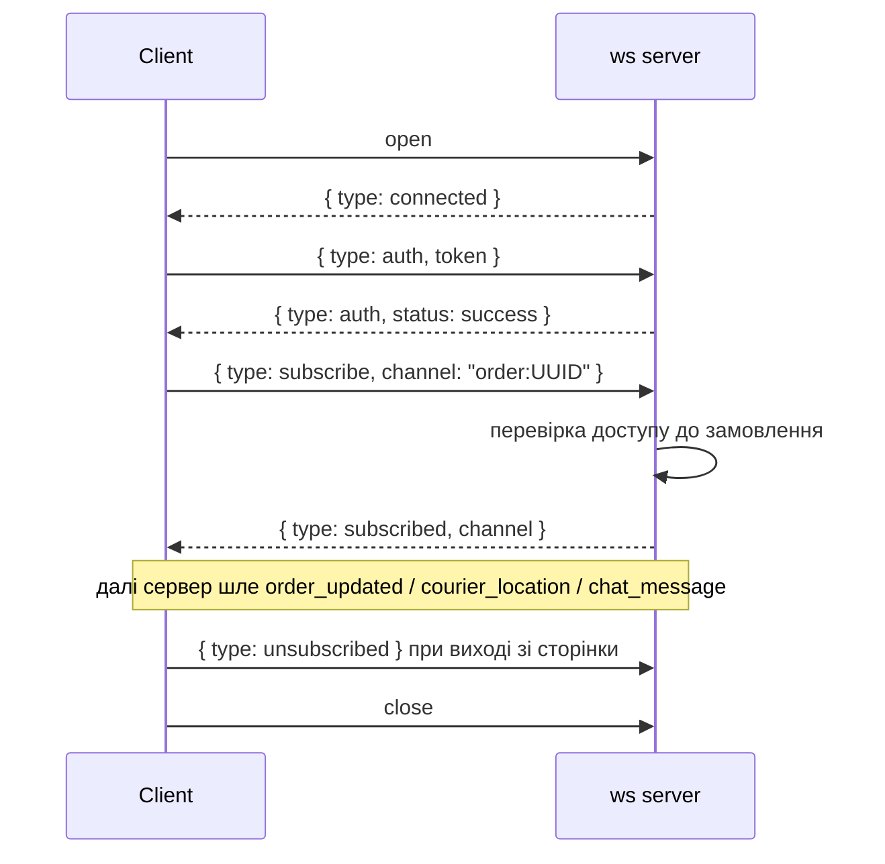

# Realtime: WebSocket і фолбеки

## Підключення

```
ws://localhost:3000/ws
```

Сервер: `setupWebSocket()` у `backend/src/websocket.ts` (`WebSocketServer` з пакета `ws`). Конверт кожного повідомлення — `{ "type": "...", "data": ... }`.

## Клієнт → сервер

| `type` | Поля | Правила |
|---|---|---|
| `auth` | `token` | JWT access. Відповідь `{ type: 'auth', status: 'success' \| 'error' }` |
| `subscribe` | `channel` | Потрібна автентифікація. Для `order:<id>` перевіряється, що клієнт — власник замовлення, призначений кур'єр або роль `owner`/`admin`/`chef` |
| `unsubscribe` | `channel` | Прибирає канал |
| `courier_location_update` | `orderId`, `lat`, `lng` | Тільки роль `courier`; замовлення мусить бути призначене цьому кур'єру; координати валідуються |

Невідомий тип → `{ type: 'error', message: 'Unknown message type' }`.

## Сервер → клієнт

| `type` | Дані | Кому |
|---|---|---|
| `connected` | `clientId` | Щойно підключеному |
| `auth` | `status` | Відповідь на автентифікацію |
| `subscribed` / `unsubscribed` | `channel` | Відповідь на підписку |
| `new_order` | замовлення | Усім підключеним (глобальний broadcast) |
| `order_updated` | замовлення | Канал `order:<id>` + глобальний broadcast |
| `order_cancelled` | замовлення | Глобальний broadcast |
| `courier_location` | `orderId`, `courierId`, `lat`, `lng`, `updatedAt` | Канал `order:<id>` + ролі `owner` та `admin` |
| `chat_message` | повідомлення | Канал `order:<id>` |
| `error` | `message` | Адресно |

## Канали

- `order:<uuid>` — єдиний канал з перевіркою доступу. Використовується для статусів, локації та чату конкретного замовлення.
- `orders` — умовний канал, який кур'єрський застосунок надсилає для сумісності. Сервер його приймає, але окремої логіки для нього немає: `new_order` / `order_updated` і так ідуть глобально.

`handleSubscribe` не зберігає список підписників на канал — підписки лежать у `Set` кожного клієнта, а розсилка йде перебором усіх клієнтів. Для локальної розробки цього достатньо.

## Хто як слухає

| Застосунок | Сокет | Що робить з подіями | Фолбек |
|---|---|---|---|
| `courier-app` | постійно після логіна | `order_updated` / `new_order` / `order_cancelled` → перезавантаження списку й поточного замовлення; `chat_message` → додає повідомлення; `courier_location` не слухає (він джерело) | полінг 15 с; локація також `PUT /orders/:id/location` |
| `frontend` (трекінг) | лише на `/orders/:id` | `order_updated` → перезавантаження трекінгу; `courier_location` → рух маркера; `chat_message` → перезавантаження повідомлень | полінг трекінгу й чату кожні 5 с |
| `frontend` (решта) | немає | — | звичайні REST-запити |
| `сhef-panel` | немає | — | `refetchInterval: 5000` |
| `ower-panel` | немає | — | 10 с (кухня), 15 с (дашборд), 30 с (аудит) |

## Життєвий цикл сокета



Клієнти перепідключаються самі: `courier-app` через 3 с, сторінка трекінгу — через 3 с, поки компонент живий.

## HTTP-фолбеки

| Дія | WS | HTTP |
|---|---|---|
| Позиція кур'єра | `courier_location_update` | `PUT /orders/:id/location` (той самий сервіс `saveCourierLocation`) |
| Статус замовлення | подія `order_updated` | `PATCH /orders/:id/status` |
| Чат | подія `chat_message` | `GET/POST /chats/order/:orderId/messages` |
| Трекінг | `courier_location` | `GET /orders/:id/tracking` |

Кур'єрський застосунок надсилає локацію обома шляхами: спочатку WS, потім HTTP. HTTP-шлях також оновлює БД, тому клієнт, який не має сокета, все одно побачить позицію через полінг.

## Безпека і обмеження

- Без `auth` не можна підписатися на канал; без ролі `courier` не можна надіслати локацію.
- Канал `order:<id>` недоступний сторонньому клієнту (перевірка власника/кур'єра/staff).
- **Глобальні broadcast-и** (`new_order`, `order_updated`, `order_cancelled`) ідуть усім підключеним сокетам, зокрема клієнту на сторінці трекінгу. Дані — повний об'єкт замовлення без позицій. Для продакшену це варто звузити до ролей/каналів.
- Немає heartbeat/ping: «мертвий» сокет виявиться лише при закритті TCP або наступній відправці.
- Немає черги повідомлень: події, надіслані під час перепідключення, втрачаються; саме тому клієнти полять стан.
- Локація — остання точка, без історії; маршрут будується на клієнті з поточної позиції та точки доставки.