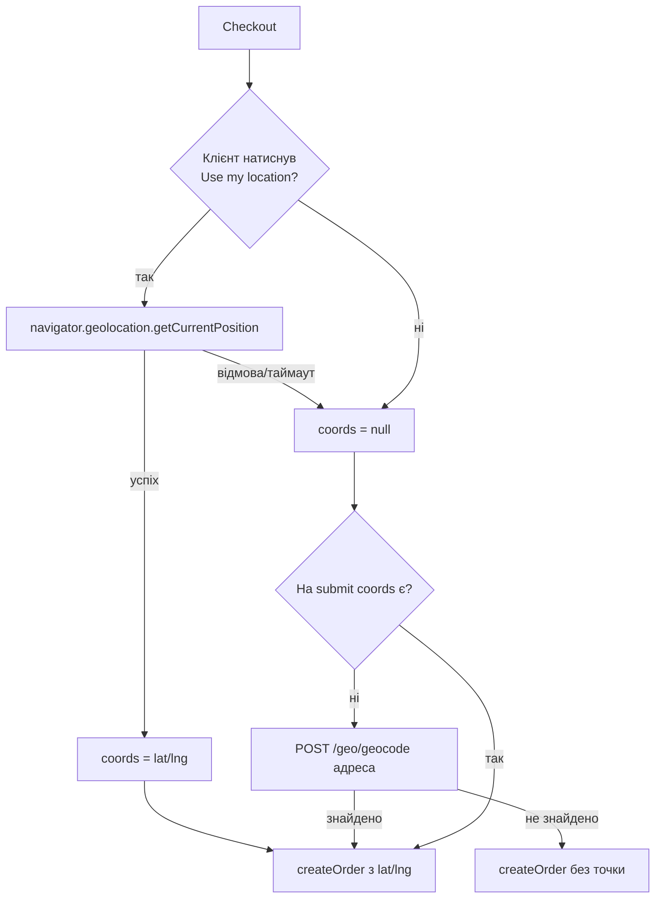

# Трекінг кур'єра і чат по замовленню

## Навіщо це

Клієнт після оформлення хоче бачити, де його замовлення; кур'єр — куди їхати; адмін — хто везе. Система зв'язує ці три сторони через три речі: точку клієнта в замовленні, позицію кур'єра та чат, прив'язаний до замовлення.

## Дані

| Що | Де зберігається | Хто пише |
|---|---|---|
| Точка клієнта | `orders.lat`, `orders.lng` | Клієнт при створенні замовлення |
| Кур'єр замовлення | `orders.courierId` | Бекенд у момент прийняття (`on_the_way`) |
| Позиція кур'єра | `courier_locations` (остання точка) | Кур'єр через WS або `PUT /orders/:id/location` |
| Чат | `chats.orderId` + `messages` | Клієнт, кур'єр, адмін/власник |

## Як з'являється точка клієнта



- Геолокація запитується лише за кнопкою, не автоматично.
- Геокодинг виконує **бекенд** (`backend/src/routes/geo.ts`), щоб не залежати від CORS і приховати політику Nominatim; результати кешуються в пам'яті.
- Якщо адреса не розпізнана — замовлення все одно створюється, кур'єр бачить текст адреси й телефон.

## Маршрут кур'єра

Сторінка `/orders/:id/map` (`courier-app/src/views/OrderRouteView.vue`):

1. Завантажує замовлення (`GET /orders/:id`) — адреса, телефон, `lat/lng`.
2. Бере власну позицію з `locationStore` (`watchPosition`).
3. Малює маркер кур'єра, маркер клієнта і лінію.
4. Запитує маршрут у публічного OSRM:

```
https://router.project-osrm.org/route/v1/driving/{lng},{lat};{lng},{lat}?overview=full&geometries=geojson
```

5. Показує відстань і ETA; якщо OSRM недоступний — пунктирну пряму й чесний статус.
6. На кожне оновлення позиції (не частіше ніж раз на 8 с) шле `courier_location_update` у WS і `PUT /orders/:id/location`.

Без власної позиції (геолокація заборонена або недоступна) стартова точка відсутня, тому маршрут не будується: кнопка «Share my location» неактивна, картка показує адресу й «Route is being prepared».

## Що бачить клієнт

Сторінка `/orders/:id` (`frontend/src/routes/orders/[id]/+page.svelte`):

- таймлайн: Placed → Cooking → Ready → On the way → Delivered;
- карта Leaflet: маркер клієнта (темний) і кур'єра (індиго) + лінія між ними;
- рядок «Courier position updated HH:MM» або «Waiting for the courier to share a position»;
- картка кур'єра з ім'ям, телефоном і кнопкою `tel:`;
- чат і деталі замовлення.

Оновлення: WS-канал `order:<id>` + полінг `GET /orders/:id/tracking` і повідомлень кожні 5 с. Після `delivered` полінг зупиняється.

## Ендпоінти трекінгу

| Метод | Шлях | Доступ | Відповідь |
|---|---|---|---|
| `GET` | `/orders/:id/tracking` | власник замовлення, призначений кур'єр, `owner`/`admin`/`chef` | `{ order, client, courier, location }` |
| `PUT` | `/orders/:id/location` | тільки `courier`, лише своє замовлення | `{ orderId, courierId, lat, lng, updatedAt }` |

`GET /orders/:id/tracking` повертає:

```json
{
  "order": { "id": "...", "status": "on_the_way", "address": "...", "items": [] },
  "client": { "lat": 48.6491, "lng": 35.0457 },
  "courier": { "id": "...", "name": "Curier 1", "phone": "+380501111111" },
  "location": { "lat": 48.4721, "lng": 35.0331, "updatedAt": "2026-11-20T11:43:08.000Z" }
}
```

Будь-яке з полів `client` / `courier` / `location` може бути `null`.

## Чат по замовленню

Схема: один чат на замовлення (`chats.orderId` unique). Учасники визначаються з замовлення:

| Хто | Як визначається | `sender` у повідомленні |
|---|---|---|
| Клієнт | `order.userId === userId` | `user` |
| Кур'єр | `order.courierId === userId` і роль `courier` | `courier` |
| Адмін / власник | роль `owner` або `admin` | `admin` |

Права:

- читати й писати може лише учасник замовлення (власник, призначений кур'єр, owner/admin);
- чужий кур'єр отримує `403`, навіть якщо бачить замовлення у списку;
- чат створюється ліниво при першому зверненні (`GET /chats/order/:orderId`).

| Метод | Шлях | Опис |
|---|---|---|
| `GET` | `/chats/order/:orderId` | Отримати або створити чат |
| `GET` | `/chats/order/:orderId/messages` | Історія (за зростанням часу) |
| `POST` | `/chats/order/:orderId/messages` | `{ "text": "..." }` → `201` |

Нове повідомлення одразу розсилається в канал `order:<id>` як `chat_message`, тому інші учасники бачать його без перезавантаження (за умови відкритого сокета).

Старий API `/chats` (клієнт ↔ адмін, без замовлення) залишився для сумісності, але жоден UI його не використовує.

## UI чату

| Застосунок | Де | Особливості |
|---|---|---|
| `frontend` | блок «Chat with courier and support» на `/orders/:id` | бульбашки: свої праворуч, інші ліворуч; `user` → «You» |
| `courier-app` | картка «Chat» на `/orders/:id` | `courier` → «You», `admin` → «Support», `user` → «Customer» |
| `ower-panel` | API доступне (роль owner/admin), окремого екрана немає | — |

## Перевірка (фактично виконано)

- REST: прийняття замовлення кур'єром → `courierId` заповнений; другий кур'єр отримує `409`; `PUT /location` → 200; `/tracking` віддає точку й кур'єра; чат `201` і історія.
- WebSocket (Node-клієнт): owner підписався на `order:<id>`, кур'єр надіслав локацію → owner отримав `courier_location`; повідомлення в чат → `chat_message`.
- Браузер: checkout з `Use my location` (у тестовому Chrome геолокація `denied`, тому спрацював геокодинг адреси); сторінка трекінгу показала таймлайн, карту, «Courier position updated», картку кур'єра; чат-повідомлення з'явилося і в клієнта, і в кур'єра; owner-панель у кухні показала «Courier: Curier 1».
- OSRM доступний (`code: Ok`, 27.7 км / 38 хв для тестової пари точок), але **маршрут у браузері не перевірений**, бо без геолокації немає стартової точки.